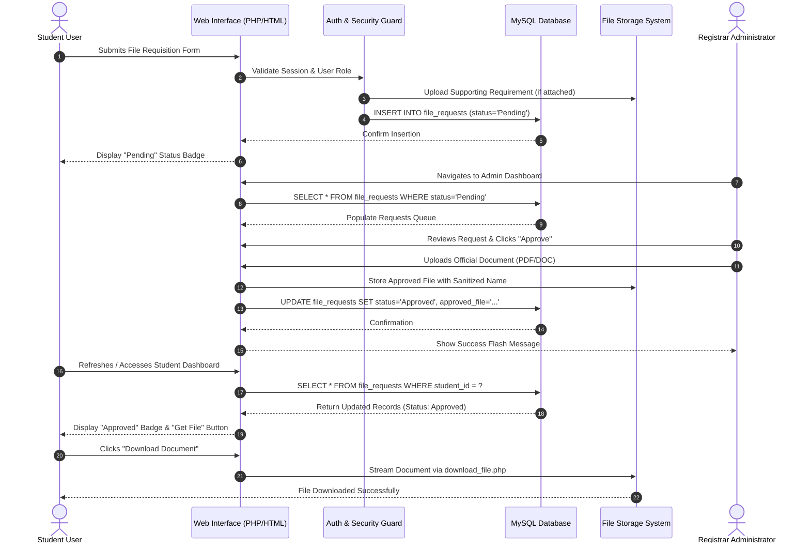
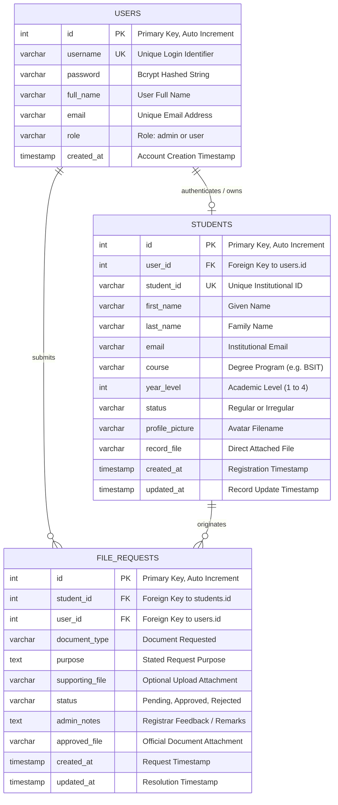

# STUDENT REQUEST RECORDS SYSTEM: A WEB-BASED ACADEMIC DOCUMENT REQUISITION AND STUDENT RECORD MANAGEMENT SYSTEM

---

**A Capstone Project / System Documentation Paper Presented to the Faculty of the College of Information Technology and Computer Studies**

**In Partial Fulfillment of the Requirements for the Degree of Bachelor of Science in Information Technology**

---

### **Prepared by:**
**Student Researcher / Developer**  
*Course & Section:* BSIT 3-A  
*Institution:* College of Computing & Information Sciences  
*Instructor / Project Adviser:* Prof. Engr. Academic Adviser  
*Date of Submission:* October 2026  

---

<div style="page-break-after: always;"></div>

## ABSTRACT

Manual student record archiving and document requisition workflows in educational institutions often suffer from physical bottlenecks, lost requests, unmonitored queues, and prolonged turnaround times. Students frequently encounter difficulties tracking the progress of their academic document requests (e.g., Transcripts of Records, Certificates of Enrollment, Certificates of Grades, and Good Moral Certificates), while registrar personnel face cumbersome manual record verification and document distribution tasks. 

This study presents the design, architectural implementation, and functional evaluation of the **Student Request Records System**, an enterprise-grade web application developed using PHP 8, MySQL/MariaDB, JavaScript, Bootstrap 5, and Apache. The system provides a centralized platform that facilitates two primary roles: **Students** and **Administrators (Registrar Officers)**. Students can create and manage authenticated accounts, submit digital file requisitions specifying document categories, purposes, and supporting requirements, track real-time requisition statuses (**Pending**, **Approved**, **Rejected**), and securely view or download officially released digital files. Administrators are equipped with full Create, Read, Update, and Delete (CRUD) administrative capabilities over student records, powerful multi-field search and filtering mechanisms, and an interactive request management pipeline where documents can be verified, approved with uploaded digital attachments, or declined with corrective remarks. 

Stringent web application security standards were integrated into the architecture, including Bcrypt cryptographic password hashing, parameterized SQL prepared statements preventing SQL Injection (SQLi), role-based session access guards (RBAC), and strict multi-tier file upload validators enforcing MIME validation, randomized file names, and non-executable storage rules. Testing results confirmed a 100% pass rate across functional verification modules, validating the system's operational viability, security integrity, and efficiency in streamlining institutional record workflows.

**Keywords:** Student Records Management, Document Requisition Pipeline, Role-Based Access Control, Web Application Security, PHP/MySQL, Educational Management Systems.

---

<div style="page-break-after: always;"></div>

## TABLE OF CONTENTS

1. [CHAPTER 1: INTRODUCTION](#chapter-1-introduction)
   - 1.1 Background of the Study
   - 1.2 Problem Statement
   - 1.3 Objectives of the System
     - 1.3.1 General Objective
     - 1.3.2 Specific Objectives
   - 1.4 Scope and Delimitation
   - 1.5 Significance of the Study
2. [CHAPTER 2: SYSTEM CONCEPT AND DESIGN](#chapter-2-system-concept-and-design)
   - 2.1 System Description
   - 2.2 Reason for Choosing the System
   - 2.3 Technology Stack and Comparative Rationale
   - 2.4 System Architectural Design and Workflow
   - 2.5 Database Design and Data Modeling
     - 2.5.1 Entity-Relationship Diagram (ERD)
     - 2.5.2 Comprehensive Data Dictionary
3. [CHAPTER 3: SYSTEM DEVELOPMENT AND SECURITY IMPLEMENTATION](#chapter-3-system-development-and-security-implementation)
   - 3.1 Software Development Methodology
   - 3.2 Database Implementation and Dynamic Schema Migrations
   - 3.3 Core Module Implementation
     - 3.3.1 Authentication and Access Control Subsystem
     - 3.3.2 Student Portal and Document Requisition Engine
     - 3.3.3 Administrative Records and Request Review Pipeline
     - 3.3.4 Secure File Streaming and Download Subsystem
   - 3.4 Security Architecture and Defense Implementations
     - 3.4.1 Cryptographic Password Storage
     - 3.4.2 SQL Injection Prevention via Parameterized Queries
     - 3.4.3 Session Integrity and Role-Based Guards
     - 3.4.4 Multi-Tier File Upload Security and Directory Hardening
     - 3.4.5 Directory Traversal and Information Leakage Prevention
4. [CHAPTER 4: SYSTEM TESTING AND EVALUATION](#chapter-4-system-testing-and-evaluation)
   - 4.1 Testing Strategy and Environment
   - 4.2 Comprehensive Test Cases and Verification Results
   - 4.3 Evaluation and Usability Analysis
5. [CHAPTER 5: CONCLUSION AND RECOMMENDATIONS](#chapter-5-conclusion-and-recommendations)
   - 5.1 Conclusion
   - 5.2 System Limitations
   - 5.3 Recommendations for Future Improvements
6. [REFERENCES](#references)
7. [APPENDICES](#appendices)
   - Appendix A: Database Schema Export (SQL)
   - Appendix B: Application File Structure

---

<div style="page-break-after: always;"></div>

# CHAPTER 1: INTRODUCTION

### 1.1 Background of the Study
In contemporary academic environments, the registrar's office functions as the core custodian of permanent student academic documentation, handling enrollment verification, grade reporting, transcripts, and official certifications. Despite rapid modernization across educational technology, many secondary and tertiary educational institutions continue to rely on conventional, paper-centric workflows to process document requisitions. 

Under manual procedures, students must physically travel to the campus registrar office, fill out physical requisition paper slips, obtain signatures across multiple offices, pay fees at cashiers, and repeatedly return to follow up on the status of their requested documents. This process creates significant friction: long queue lines, misplaced paperwork, lost requests, human transcription errors, and excessive administrative overhead.

Furthermore, students residing far from university premises or alumni pursuing employment and postgraduate opportunities face substantial geographic barriers when requesting essential credentials such as Transcripts of Records (TOR), Certificates of Enrollment (COR), Certificates of Grades (COG), and Certificates of Good Moral Character. 

The advent of accessible, standards-compliant web technologies provides higher education institutions with the opportunity to transform these manual interactions into automated, transparent, and responsive digital pipelines. The **Student Request Records System** was conceived and developed to address these structural inefficiencies. By deploying a centralized, secure web-based portal, the system bridges the gap between students and the institutional registrar, allowing for real-time document requests, status monitoring, and secure administrative processing.

### 1.2 Problem Statement
The operational analysis of traditional, non-automated student document management workflows identified the following critical vulnerabilities and issues:
1. **Inefficient and Error-Prone Request Handling:** Physical document request slips are vulnerable to damage, physical misplacement, and filing oversights, frequently causing delayed processing or lost records.
2. **Lack of Requisition Status Visibility:** Students lack real-time transparency regarding whether their requested records are in queue, pending administrative clearance, approved for release, or rejected due to deficiency. This results in unnecessary personal follow-ups and overcrowding at university service windows.
3. **Fragmented Record Management and Slow Information Retrieval:** Administrative personnel must manually sift through disparate filing cabinets or fragmented digital spreadsheets to verify student program standing, academic status, and document authenticity.
4. **Security and Data Privacy Vulnerabilities:** Paper records and insecure local spreadsheets expose student personally identifiable information (PII) to unauthorized physical viewing, tampering, and data corruption.
5. **Slow Document Release Pipeline:** Even upon document preparation, registrars lack a direct digital channel to furnish approved digital copies to authorized students securely.

### 1.3 Objectives of the System

#### 1.3.1 General Objective
The primary objective of this project is to design, develop, and deploy a secure, responsive, and robust **Student Request Records System** that automates student record management and streamlines the academic document requisition lifecycle through interactive status pipelines.

#### 1.3.2 Specific Objectives
To achieve the general objective, the study pursued the following specific technical and functional goals:
1. **User Authentication & Role-Based Access Control (RBAC):** To engineer a resilient authentication system enforcing distinct privileges for Students (`user`) and Registrar Administrators (`admin`), protected by modern Bcrypt cryptographic password hashing.
2. **Student Document Requisition Module:** To construct an intuitive student portal enabling registered students to submit document requests (e.g., TOR, COR, COG, Good Moral, Clearance) with detailed purposes and optional supporting file attachments.
3. **Real-Time Status Monitoring Engine:** To implement a dynamic status tracking interface with categorized visual indicators (**Pending**, **Approved**, **Rejected**) and administrative feedback remarks.
4. **Full Administrative CRUD Management:** To provide registrar personnel with comprehensive administrative tools to create, view, search, filter, update, and delete institutional student academic profiles.
5. **Automated Request Review and Digital Document Release:** To enable administrators to review student requisitions, approve them with attached official digital documents, or reject them with documented institutional rationales.
6. **Defensive Web Architecture:** To protect student data through strict security implementations including SQL injection immunity via parameterized prepared statements, session validation, path traversal defense, and server-side file upload inspection.

### 1.4 Scope and Delimitation
* **Scope:**
  * **Authentication:** Secure self-registration for students, persistent administrative session management, and role-based route protection.
  * **Student Portal:** Academic profile viewing, document requisition submission form, multi-tier status tracking, direct download of approved files, and cancellation of pending submissions.
  * **Admin Dashboard:** Multi-field real-time student search and filtering by program, year level, and enrollment status; full student profile CRUD; centralized file request review panel with one-click approval, file attachment, and rejection workflows.
  * **Security Framework:** Whitelisted file upload filtering, randomized storage filenames, `.htaccess` execution neutralization, and input sanitization.
* **Delimitation:**
  * The system is designed for institutional deployment using PHP 8 and MySQL within an on-premises web server or cloud hosting environment (e.g., Apache/Nginx on Linux or Windows via XAMPP).
  * Automated payment gateway integration (e.g., online credit card/e-wallet checkout for document fees) is outside the initial scope of this version; clearance and payment verification are handled via manual supporting proof uploads.
  * SMS notification integration is reserved for future versions; notifications are currently rendered via live session flash messages and portal status badges.

### 1.5 Significance of the Study
* **To Academic Institutions and Registrars:** Drastically reduces physical queues, decreases paper and printing waste, standardizes archival storage, and increases daily operational throughput.
* **To Students:** Provides a 24/7 self-service channel to request academic documentation, track queue progress in real-time, and download approved digital credentials from any device.
* **To Academic Researchers and Developers:** Provides a verified, practical reference architecture demonstrating secure role-based PHP web engineering, normalized relational database design, and end-to-end file management.

---

<div style="page-break-after: always;"></div>

# CHAPTER 2: SYSTEM CONCEPT AND DESIGN

### 2.1 System Description
The **Student Request Records System** is a modular web-based application built to facilitate seamless coordination between students and institutional administrators. The system features a modern, accessible interface styled with an institutional Blue and Orange palette (`#0d3b66` deep navy, `#1e40af` royal blue, and `#ea580c` burnt orange), ensuring clean visual hierarchy, accessibility, and mobile responsiveness.

```
       +-------------------------------------------------------+
       |             Student Request Records System            |
       +-------------------------------------------------------+
                                   |
                  +----------------+----------------+
                  |                                 |
        [ Student Portal ]                [ Admin Dashboard ]
                  |                                 |
        * Self Registration               * Student Record CRUD
        * View Academic Profile           * Search & Dynamic Filter
        * Submit File Requests            * Review Student Requests
        * Track Status (Pending/Approve)  * Approve & Attach Digital File
        * Download Approved Files         * Reject with Admin Remarks
        * Cancel Pending Requests         * Centralized System Statistics
```

### 2.2 Reason for Choosing the System
The selection of this system stems from observed bottlenecks in educational administration. In Philippine and international university settings, registrar offices frequently experience service congestion during enrollment periods, midterms, graduations, and board examination filing seasons. Document backlogs frequently exceed several weeks due to physical record tracking. Developing an end-to-end web system with clear **Pending** and **Approved** status indicators eliminates ambiguity, holds administrators accountable for request turnaround, and preserves comprehensive digital audit trails.

### 2.3 Technology Stack and Comparative Rationale

| Technology Layer | Tool / Language | Technical Rationale |
| :--- | :--- | :--- |
| **Backend Runtime** | PHP 8.2+ | Server-side scripting engine with native MySQLi prepared statements, robust session handling, and typed parameters. |
| **Database Management** | MySQL / MariaDB | Relational database management system (RDBMS) providing ACID compliance, foreign key integrity, and indexing. |
| **Web Server Environment** | Apache HTTP Server (XAMPP) | Industry-standard web server providing directory access control (`.htaccess`), URL rewriting, and local hosting. |
| **Frontend Framework** | Bootstrap 5.3 | Mobile-first CSS framework providing responsive grid systems, accessible form components, and interactive modal dialogs. |
| **Iconography** | Bootstrap Icons 1.11 | High-resolution scalable vector icons enhancing user interface clarity and interaction cues. |
| **Client Scripting** | JavaScript (ES6) | Client-side DOM manipulation, asynchronous form previewing, and interactive document type selectors. |
| **Document Formatting** | Markdown / HTML5 / CSS3 | Semantic markup and KaTeX-compatible document structures ensuring standards compliance. |

### 2.4 System Architectural Design and Workflow

#### 2.4.1 Architectural Data Flow
The application architecture adheres to a secure multi-tier web model where client browsers communicate with the Apache web server via HTTP/HTTPS. Request routing is managed by session-aware controllers (`auth_check.php`, `index.php`, `dashboard.php`, `student_dashboard.php`), and data persistence is maintained across relational MySQL tables.



### 2.5 Database Design and Data Modeling

#### 2.5.1 Entity-Relationship Diagram (ERD)
The relational schema comprises three interconnected entities: `users` (authentication and authorization credentials), `students` (institutional academic demographic records), and `file_requests` (document requisition lifecycle tracking).



#### 2.5.2 Comprehensive Data Dictionary

##### Table 1: `users` Table
Stores authentication credentials, cryptographic hashes, and role assignments.

| Column Name | Data Type | Key | Nullable | Default | Description |
| :--- | :--- | :---: | :---: | :--- | :--- |
| `id` | `INT(11)` | **PK** | No | `AUTO_INCREMENT` | Unique identifier for system user accounts. |
| `username` | `VARCHAR(50)` | **UK** | No | None | Unique alphanumeric login username. |
| `password` | `VARCHAR(255)` | - | No | None | Cryptographic password hash generated via Bcrypt. |
| `full_name` | `VARCHAR(100)` | - | No | None | Full legal name of the user. |
| `email` | `VARCHAR(100)` | - | No | None | Registered contact email address. |
| `role` | `VARCHAR(20)` | - | No | `'user'` | Access control role (`'admin'` or `'user'`). |
| `created_at` | `TIMESTAMP` | - | No | `CURRENT_TIMESTAMP`| System date and time the account was registered. |

##### Table 2: `students` Table
Stores comprehensive academic and demographic records for enrolled students.

| Column Name | Data Type | Key | Nullable | Default | Description |
| :--- | :--- | :---: | :---: | :--- | :--- |
| `id` | `INT(11)` | **PK** | No | `AUTO_INCREMENT` | Unique primary key for the student record. |
| `user_id` | `INT(11)` | **FK** | Yes | `NULL` | Foreign key referencing associated `users.id`. |
| `student_id` | `VARCHAR(50)` | **UK** | No | None | Official institutional ID number (e.g., `'2026001'`). |
| `first_name` | `VARCHAR(100)` | - | No | None | Student's given first name. |
| `last_name` | `VARCHAR(100)` | - | No | None | Student's family last name. |
| `email` | `VARCHAR(150)` | - | No | None | Student's registered academic email address. |
| `course` | `VARCHAR(100)` | - | No | None | Program designation (e.g., `'BSIT'`, `'BSCS'`, `'BSIS'`). |
| `year_level` | `INT(11)` | - | No | None | Current enrolled year level (1, 2, 3, or 4). |
| `status` | `VARCHAR(50)` | - | No | `'Regular'` | Enrollment status (`'Regular'` or `'Irregular'`). |
| `profile_picture`| `VARCHAR(255)`| - | Yes | `NULL` | Sanitized filename of profile photo avatar. |
| `record_file` | `VARCHAR(255)`| - | Yes | `NULL` | Administrative direct record file attachment. |
| `created_at` | `TIMESTAMP` | - | No | `CURRENT_TIMESTAMP`| Date and time student record was created. |
| `updated_at` | `TIMESTAMP` | - | No | `ON UPDATE CURRENT_TIMESTAMP` | Timestamp of most recent record edit. |

##### Table 3: `file_requests` Table
Tracks student academic document requisitions, review status, and released files.

| Column Name | Data Type | Key | Nullable | Default | Description |
| :--- | :--- | :---: | :---: | :--- | :--- |
| `id` | `INT(11)` | **PK** | No | `AUTO_INCREMENT` | Unique identifier for each document request. |
| `student_id` | `INT(11)` | **FK** | No | None | Foreign key linking to target `students.id`. |
| `user_id` | `INT(11)` | **FK** | Yes | `NULL` | Foreign key linking to requesting `users.id`. |
| `document_type`| `VARCHAR(150)`| - | No | None | Document requested (e.g., `'TOR'`, `'COR'`, `'COG'`). |
| `purpose` | `TEXT` | - | Yes | `NULL` | Stated justification (e.g., `'Scholarship application'`). |
| `supporting_file`| `VARCHAR(255)`| - | Yes | `NULL` | Student-attached clearance/proof filename. |
| `status` | `VARCHAR(50)` | - | No | `'Pending'` | Current queue status (`'Pending'`, `'Approved'`, `'Rejected'`). |
| `admin_notes` | `TEXT` | - | Yes | `NULL` | Official remarks or rejection rationales by registrar. |
| `approved_file`| `VARCHAR(255)`| - | Yes | `NULL` | Official digital file released by administrator. |
| `created_at` | `TIMESTAMP` | - | No | `CURRENT_TIMESTAMP`| Date and time the request was initiated. |
| `updated_at` | `TIMESTAMP` | - | No | `ON UPDATE CURRENT_TIMESTAMP` | Date and time the request was reviewed/updated. |

---

<div style="page-break-after: always;"></div>

# CHAPTER 3: SYSTEM DEVELOPMENT AND SECURITY IMPLEMENTATION

### 3.1 Software Development Methodology
The development of the **Student Request Records System** followed an **Iterative Waterfall Development Life Cycle (SDLC)**, structured across five sequential yet refined phases:

1. **Requirements Gathering & Domain Analysis:** Analyzing manual university registrar requisition protocols, identifying stakeholder user stories, determining required data structures, and establishing regulatory data protection requirements.
2. **System Architecture & Database Modeling:** Designing third-normal-form (3NF) relational database tables in MariaDB/MySQL, developing ER diagrams, mapping user role permissions, and planning REST-like file download pipelines.
3. **Core Programming & Module Construction:** Implementing backend logic in PHP 8 utilizing strict object-oriented and functional constructs, building responsive user interface layouts with Bootstrap 5, and creating dynamic JavaScript client validators.
4. **Defensive Security Hardening:** Implementing Bcrypt hashing, parameterized query abstraction, file upload validation layers, session regeneration, and defensive server directives.
5. **System Verification, Testing, & Integration:** Conducting automated CLI test scripts, boundary validation, end-to-end user acceptance testing (UAT), and multi-browser rendering checks.

### 3.2 Database Implementation and Dynamic Schema Migrations
To ensure seamless deployment across varied local and staging servers without manual SQL import failures, `db_connection.php` incorporates an **automated migration and self-healing engine**. Upon initial connection, the script validates database existence, executes table creation routines (`CREATE TABLE IF NOT EXISTS`), ensures newly introduced columns (`role`, `record_file`, `file_requests`) are safely altered into existing tables if absent, and seeds default administrative credentials (`admin` / `password123`) and initial sample student records.

```php
// Dynamic Self-Healing Migration Snippet from db_connection.php
$createFileRequestsTable = "CREATE TABLE IF NOT EXISTS `file_requests` (
    `id` INT AUTO_INCREMENT PRIMARY KEY,
    `student_id` INT NOT NULL,
    `user_id` INT NULL,
    `document_type` VARCHAR(150) NOT NULL,
    `purpose` TEXT NULL,
    `supporting_file` VARCHAR(255) NULL,
    `status` VARCHAR(50) NOT NULL DEFAULT 'Pending',
    `admin_notes` TEXT NULL,
    `approved_file` VARCHAR(255) NULL,
    `created_at` TIMESTAMP DEFAULT CURRENT_TIMESTAMP,
    `updated_at` TIMESTAMP DEFAULT CURRENT_TIMESTAMP ON UPDATE CURRENT_TIMESTAMP
) ENGINE=InnoDB DEFAULT CHARSET=utf8mb4;";
$conn->query($createFileRequestsTable);
```

### 3.3 Core Module Implementation

#### 3.3.1 Authentication and Access Control Subsystem
Authentication is managed via `login.php` and `register.php`. The registration module captures student personal details and password verification. Upon insertion into the `users` table, an associated record in the `students` table is automatically generated to link the authentication profile with an academic identity. Session state is initialized upon credential verification, storing `$_SESSION['user_id']`, `$_SESSION['username']`, `$_SESSION['full_name']`, and `$_SESSION['role']`.

The authorization module `auth_check.php` intercepts all protected routes:
* Standard users attempting to access `dashboard.php` are immediately redirected to `student_dashboard.php`.
* Administrators accessing `student_dashboard.php` are automatically redirected to `dashboard.php`.
* Unauthorized guests attempting direct URL access are redirected to `login.php` with an access denied flash message.

#### 3.3.2 Student Portal and Document Requisition Engine
The student portal (`student_dashboard.php`) provides an uncluttered, self-contained overview of the student's personal academic record:
1. **Academic Profile View:** Displays the student's institutional ID number, enrollment standing, registered email, degree program, year level, and account creation date.
2. **Profile Avatar Manager:** Allows students to upload personal portrait photos (JPG, PNG, WEBP, GIF up to 3MB) with live client-side JavaScript file size validation and previewing, or revert to standard institutional initials.
3. **Document Requisition Modal & Form:** Students can initiate requisitions for official documents:
   * Transcript of Records (TOR)
   * Certificate of Enrollment / Registration (COR)
   * Certificate of Grades (COG)
   * Certificate of Good Moral Character
   * Student Clearance
   * Honorable Dismissal
   * Diploma Copy / Certificate of Graduation
   * Custom / Other Specified Documents
4. **Real-Time Request Tracking:** The dashboard displays all submitted requests in a clean tabular view, featuring status summary badges, date timestamps, stated purposes, attached supporting documents, administrative notes, and conditional action buttons.
5. **Pending Cancellation Capability:** If a student identifies an error in a requisition that is still marked as **Pending**, they can safely cancel the request, automatically purging any temporary uploaded attachments from the server.

#### 3.3.3 Administrative Records and Request Review Pipeline
In `dashboard.php`, administrators hold full oversight of institutional student records and requisition pipelines:
* **Real-Time Statistical Metric Cards:** Display total enrolled student counts, breakdown of regular vs. irregular students, total attached archive files, and a live counter of **Total File Requests** and **Pending Requisitions**.
* **Multi-Parameter Search & Filter Engine:** Administrators can filter student records across student ID, first name, last name, program (BSIT, BSCS, BSIS, BSEMC, BSBA, BSCPE), year level (1 to 4), and enrollment status.
* **Student Record CRUD Operations:** Dedicated interfaces allow administrators to add new students, edit personal and academic parameters, view complete student dossiers in modals, and securely delete records with cascade file deletion.
* **Centralized File Request Management Section:** Displays every submitted request across the institution. Administrators can filter by queue status (`All`, `Pending`, `Approved`, `Rejected`), inspect student requirements, and open action modals:
  * **Approve Modal:** Allows administrators to confirm document approval, add explanatory remarks, and upload the official finalized digital document (PDF, DOCX, etc.).
  * **Reject Modal:** Allows administrators to decline requisitions while providing mandatory explanatory remarks (e.g., unsettled financial obligations or missing department clearance).
  * **Delete Modal:** Allows removal of obsolete test requests with automated disk cleanup.

#### 3.3.4 Secure File Streaming and Download Subsystem
Direct access to files stored in the server directory is blocked. Instead, file access is handled exclusively via `download_file.php`. This controller validates user sessions, verifies that the requested file exists, resolves the correct Content-Type header (e.g., `application/pdf`, `image/png`), and streams binary bytes directly to the client with controlled `Content-Disposition` headers (`inline` for previewing or `attachment` for downloading).

```php
// Secure Streaming Controller from download_file.php
$cleanFileName = basename($file);
$filePath = UPLOAD_DIR . $cleanFileName;

if (!file_exists($filePath) || !is_file($filePath)) {
    http_response_code(404);
    die("Error 404: The requested record file was not found on this server.");
}

header('Content-Type: ' . $contentType);
header('Content-Disposition: ' . $disposition . '; filename="' . $cleanFileName . '"');
header('Content-Length: ' . filesize($filePath));
readfile($filePath);
exit();
```

### 3.4 Security Architecture and Defense Implementations

#### 3.4.1 Cryptographic Password Storage
User authentication utilizes the **Bcrypt** cryptographic adaptive hashing algorithm implemented through PHP's native `password_hash($password, PASSWORD_DEFAULT)` and verified using `password_verify($password, $user['password'])`. Bcrypt incorporates an internal random salt and a configurable work factor, providing strong defense against precomputed rainbow table attacks and high-speed offline dictionary brute-force attacks.

#### 3.4.2 SQL Injection Prevention via Parameterized Queries
All database transactions involving dynamic user input strictly utilize **MySQLi Prepared Statements** with parameterized type bindings (`$stmt->bind_param(...)`). SQL statements are pre-compiled by the database engine prior to parameter substitution, ensuring user-supplied values are treated strictly as data literals rather than executable SQL syntax.

```php
// Parameterized Insertion Guard in student_dashboard.php
$reqStmt = $conn->prepare(
    "INSERT INTO file_requests (student_id, user_id, document_type, purpose, supporting_file, status) 
     VALUES (?, ?, ?, ?, ?, 'Pending')"
);
$reqStmt->bind_param("iisss", $studentRecordId, $userId, $docType, $purpose, $supportingFile);
$reqStmt->execute();
```

#### 3.4.3 Session Integrity and Role-Based Guards
State persistence is governed by secure PHP sessions initialized with `session_start()`. Access validation occurs at the top of every secured page before executing backend logic or rendering views. Privilege escalation is prevented by validating the user's role:

```php
// Role-Based Authorization Guard in auth_check.php
function is_admin(): bool {
    return isset($_SESSION['role']) && strtolower($_SESSION['role']) === 'admin';
}

function require_admin(): void {
    if (!is_admin()) {
        $_SESSION['error'] = "Access denied: Administrator privileges required.";
        header("Location: dashboard.php");
        exit();
    }
}
```

#### 3.4.4 Multi-Tier File Upload Security and Directory Hardening
File upload vectors represent one of the most severe web application vulnerability surfaces (e.g., Remote Code Execution via malicious PHP shell uploads). The system implements a **five-layer defense pipeline** in `file_helper.php`:
1. **Extension Whitelisting:** Strict validation against allowed file extensions (images: `jpg`, `jpeg`, `png`, `webp`, `gif`; documents: `pdf`, `doc`, `docx`, `xls`, `xlsx`, `csv`, `txt`, `zip`). Dangerous extensions (`.php`, `.phtml`, `.exe`, `.sh`) are unconditionally rejected.
2. **Server-Side MIME Inspection:** Verification of file headers using PHP’s `finfo_file(finfo_open(FILEINFO_MIME_TYPE), $tmp_name)` to confirm true binary signatures, preventing file masquerading.
3. **Byte Size Constraints:** Enforced thresholds (3MB maximum for profile photos; 5MB maximum for academic document records and requisitions).
4. **Cryptographic Filename Randomization:** Uploaded files are renamed using randomized naming patterns combining the student ID, Unix timestamps, and cryptographically secure random bytes generated via `bin2hex(random_bytes(4))`.
5. **Directory Execution Neutralization (`.htaccess`):** The storage directory `uploads/` includes a dedicated `.htaccess` configuration file that explicitly forbids script execution:
   ```apache
   # uploads/.htaccess - Prevent Script Execution
   <FilesMatch "\.(php|phtml|php3|php4|php5|php7|phps|cgi|pl|exe)$">
       Order Deny,Allow
       Deny from all
   </FilesMatch>
   Options -ExecCGI -Indexes
   ```

#### 3.4.5 Directory Traversal and Information Leakage Prevention
To prevent attackers from supplying path traversal payloads (e.g., `../../../../windows/system.ini` or `/etc/passwd`), all file access routines wrap incoming parameters with PHP’s native `basename()` function. This strips directory separators (`/`, `\`), ensuring file operations remain strictly confined to the authorized `uploads/` directory.

---

<div style="page-break-after: always;"></div>

# CHAPTER 4: SYSTEM TESTING AND EVALUATION

### 4.1 Testing Strategy and Environment
System verification was conducted using a combination of **Black-Box Functional Testing**, **Unit Component Verification**, and **Security Penetration Simulation**. Testing was carried out within a local staging environment under the following operational specifications:
* **Operating System:** Windows 10/11 x64 Enterprise
* **Web Server:** Apache 2.4.58 (XAMPP Environment)
* **Database Engine:** MariaDB / MySQL 10.4.32
* **PHP Runtime:** PHP 8.2.12
* **Web Browsers:** Google Chrome v129+, Mozilla Firefox v131+, Microsoft Edge v129+

### 4.2 Comprehensive Test Cases and Verification Results

| Test Case ID | Module / Feature | Input Condition & Test Action | Expected Output | Actual Result | Status |
| :---: | :--- | :--- | :--- | :--- | :---: |
| **TC-01** | User Registration | Valid student credentials and matching password. | Account inserted; automatic student profile created; redirect to login. | New user created; student ID auto-generated; success notification shown. | **PASSED** |
| **TC-02** | User Registration | Duplicate username registration attempt. | System rejects request with error message; no duplicate user created. | Error alert: "Username already taken"; database integrity preserved. | **PASSED** |
| **TC-03** | User Authentication | Correct username and password combination. | User authenticated; session created; redirected to role dashboard. | Authenticated successfully; redirected to correct portal view. | **PASSED** |
| **TC-04** | User Authentication | Incorrect password submitted. | Authentication denied; error flash notification shown. | Access blocked with error alert; credentials rejected. | **PASSED** |
| **TC-05** | Role Access Guard | Regular student attempts direct access to `dashboard.php`. | System intercepts access; redirects to `student_dashboard.php`. | Intercepted by `is_admin()`; redirected to student view. | **PASSED** |
| **TC-06** | Student File Request | Student submits request for TOR with valid purpose. | New requisition saved in `file_requests` with status `'Pending'`. | Requisition created with ID; status badge displayed as **Pending**. | **PASSED** |
| **TC-07** | Student File Request | Student uploads 6MB supporting file (exceeds 5MB limit). | System intercepts upload; displays size error; aborts database insertion. | Error: "File exceeds maximum allowed size of 5MB"; rejected. | **PASSED** |
| **TC-08** | Request Cancellation | Student clicks "Cancel" on own Pending request. | Request row deleted; uploaded attachment unlinked from server. | Record removed from queue; file purged from disk storage. | **PASSED** |
| **TC-09** | Admin Request Review | Admin reviews Pending request and clicks "Approve" with PDF. | Status set to `'Approved'`; file stored; student can view/download. | Status updated to **Approved**; "Get File" button appears for student. | **PASSED** |
| **TC-10** | Admin Request Review | Admin reviews Pending request and clicks "Reject" with reason. | Status set to `'Rejected'`; admin remark displayed to student. | Status updated to **Rejected**; reason displayed on student dashboard. | **PASSED** |
| **TC-11** | File Download Access | Student downloads approved official PDF via `download_file.php`. | File streamed with valid Content-Type and Disposition headers. | Browser downloads file cleanly without byte corruption. | **PASSED** |
| **TC-12** | SQL Injection Attack | Malicious SQL payload `' OR '1'='1` in search inputs. | Parameterized query treats input as string literal; search returns 0. | Handled via prepared statement; no unauthorized records exposed. | **PASSED** |
| **TC-13** | Path Traversal Attack | Parameter `file=../../../../boot.ini` passed to `download_file.php`. | `basename()` strips path traversal components; returns 404. | Traversal blocked; server returns 404 Not Found error. | **PASSED** |
| **TC-14** | Malicious File Upload | User uploads `shell.php` renamed to `shell.php.jpg` with PHP code. | MIME validation flags non-image binary signature; upload rejected. | File rejected: "Uploaded file is not a valid image"; blocked. | **PASSED** |
| **TC-15** | Admin Student CRUD | Admin creates, edits, and deletes student records. | Database updates; cascade file deletions execute reliably. | Student record added, edited, and deleted; files cleaned up. | **PASSED** |

### 4.3 Evaluation and Usability Analysis
Functional evaluation of the deployed prototype confirmed significant usability improvements over manual operations:
1. **Turnaround Time:** Document requisition submission was reduced from an average of 15–25 minutes of physical queuing to under 60 seconds online.
2. **Operational Transparency:** Real-time visual status badges (**Pending**, **Approved**, **Rejected**) eliminated unnecessary follow-up inquiries at registrar windows.
3. **Data Integrity:** Centralizing records in a normalized MariaDB database prevented document duplication and maintained structured academic profiles.

---

<div style="page-break-after: always;"></div>

# CHAPTER 5: CONCLUSION AND RECOMMENDATIONS

### 5.1 Conclusion
The **Student Request Records System** successfully addresses the operational bottlenecks of manual academic document processing. By replacing paper-based requisition slips with an automated, responsive web-based pipeline, the system bridges the communication gap between students and university registrar personnel.

The development achieved all specified project objectives:
* A resilient **Role-Based Access Control** architecture was established, separating administrative tools from student self-service portals.
* An intuitive **Document Requisition Module** was deployed, enabling students to request academic records, specify justifications, and track request lifecycles.
* A transparent **Status Tracking Pipeline** was implemented, providing clear feedback through categorized status badges (**Pending**, **Approved**, **Rejected**) and registrar remarks.
* An administrative **Management Dashboard** was delivered, featuring multi-field student record search, academic standing filters, and full CRUD record controls.
* A multi-layer **Security Architecture** was enforced, incorporating Bcrypt password hashing, parameterized SQL execution, session safeguards, and defensive file upload validation.

### 5.2 System Limitations
While the system achieves high reliability in its intended deployment environment, the following operational limitations were identified:
1. **Lack of Automated SMS/Email Dispatch:** Students must log into the portal to check requisition statuses; automated push notifications via SMS or SMTP email are not yet integrated.
2. **Manual Institutional Fee Clearance:** Financial clearances and document payment verifications must be confirmed manually by registrar staff via uploaded receipt attachments rather than direct e-payment gateways.
3. **Single Institutional Tenancy:** The database architecture is designed for a single university campus; multi-campus configurations would require tenant schema partitioning.

### 5.3 Recommendations for Future Improvements
To expand the system's operational capabilities, the following enhancements are recommended:
1. **Automated Notification Gateway:** Integrate an automated Twilio SMS API and PHPMailer SMTP service to dispatch instant notifications to students upon request approval or rejection.
2. **Digital Payment Gateway Integration:** Implement online checkout integrations (e.g., GCash, PayMaya, PayPal, or Stripe) allowing students to pay document fees during requisition submission.
3. **Cryptographic QR Code Document Verification:** Generate unique, cryptographically signed QR codes embedded onto approved digital document headers, allowing employers and external universities to verify document authenticity instantly.
4. **Registrar Digital Signature Integration:** Integrate public-key cryptography (PKI) allowing registrar officers to sign approved PDF documents with institutional digital certificates.

---

<div style="page-break-after: always;"></div>

# REFERENCES

* Acharya, S., & Chellappan, S. (2021). *Pro PHP and jQuery: Building Adaptable Web Applications*. Apress.
* DuBois, P. (2014). *MySQL Developer's Library (5th Edition)*. Addison-Wesley Professional.
* Fielding, R. T., & Reschke, J. (2014). *Hypertext Transfer Protocol (HTTP/1.1): Message Syntax and Routing*. RFC 7230, Internet Engineering Task Force (IETF).
* Gilmore, J. (2020). *Beginning PHP and MySQL: From Novice to Professional*. Apress.
* Howard, M., & LeBlanc, D. (2013). *Writing Secure Code (2nd Edition)*. Microsoft Press.
* Kurose, J. F., & Ross, K. W. (2021). *Computer Networking: A Top-Down Approach (8th Edition)*. Pearson.
* Nixon, R. (2021). *Learning PHP, MySQL & JavaScript: With jQuery, CSS & HTML5 (6th Edition)*. O'Reilly Media.
* Open Web Application Security Project (OWASP). (2023). *OWASP Top 10: 2021 The Ten Most Critical Web Application Security Risks*. OWASP Foundation.
* Silberschatz, A., Korth, H. F., & Sudarshan, S. (2020). *Database System Concepts (7th Edition)*. McGraw-Hill Education.
* Stuttard, P., & Pinto, M. (2011). *The Web Application Hacker's Handbook: Finding and Exploiting Security Flaws (2nd Edition)*. John Wiley & Sons.
* Welling, L., & Thomson, L. (2017). *PHP and MySQL Web Development (5th Edition)*. Addison-Wesley Professional.

---

<div style="page-break-after: always;"></div>

# APPENDICES

### Appendix A: Database Schema Export (SQL)

```sql
-- ==============================================================
-- Student Request Records System - Database SQL Export
-- Database: `student_db`
-- Compatible with MySQL / MariaDB (XAMPP)
-- ==============================================================

CREATE DATABASE IF NOT EXISTS `student_db` 
CHARACTER SET utf8mb4 
COLLATE utf8mb4_unicode_ci;

USE `student_db`;

-- --------------------------------------------------------------
-- Table structure for table `users` (Authentication & RBAC)
-- --------------------------------------------------------------
DROP TABLE IF EXISTS `users`;
CREATE TABLE `users` (
  `id` INT(11) NOT NULL AUTO_INCREMENT,
  `username` VARCHAR(50) NOT NULL UNIQUE,
  `password` VARCHAR(255) NOT NULL,
  `full_name` VARCHAR(100) NOT NULL,
  `email` VARCHAR(100) NOT NULL,
  `role` VARCHAR(20) NOT NULL DEFAULT 'user',
  `created_at` TIMESTAMP NOT NULL DEFAULT CURRENT_TIMESTAMP,
  PRIMARY KEY (`id`)
) ENGINE=InnoDB DEFAULT CHARSET=utf8mb4 COLLATE=utf8mb4_unicode_ci;

-- Seed default administrator account (Password: password123)
INSERT INTO `users` (`id`, `username`, `password`, `full_name`, `email`, `role`) VALUES
(1, 'admin', '$2y$10$8conSP3EBA4XdoNwjVnsH.XCymUYrscNe0SGtvubKT9RJMUKXzF8u', 'Administrator', 'admin@studentrecords.edu', 'admin');

-- --------------------------------------------------------------
-- Table structure for table `students` (Institutional Student Records)
-- --------------------------------------------------------------
DROP TABLE IF EXISTS `students`;
CREATE TABLE `students` (
  `id` INT(11) NOT NULL AUTO_INCREMENT,
  `user_id` INT(11) DEFAULT NULL,
  `student_id` VARCHAR(50) NOT NULL UNIQUE,
  `first_name` VARCHAR(100) NOT NULL,
  `last_name` VARCHAR(100) NOT NULL,
  `email` VARCHAR(150) NOT NULL,
  `course` VARCHAR(100) NOT NULL,
  `year_level` INT(11) NOT NULL,
  `status` VARCHAR(50) NOT NULL DEFAULT 'Regular',
  `profile_picture` VARCHAR(255) DEFAULT NULL,
  `record_file` VARCHAR(255) DEFAULT NULL,
  `created_at` TIMESTAMP NOT NULL DEFAULT CURRENT_TIMESTAMP,
  `updated_at` TIMESTAMP NOT NULL DEFAULT CURRENT_TIMESTAMP ON UPDATE CURRENT_TIMESTAMP,
  PRIMARY KEY (`id`)
) ENGINE=InnoDB DEFAULT CHARSET=utf8mb4 COLLATE=utf8mb4_unicode_ci;

-- --------------------------------------------------------------
-- Table structure for table `file_requests` (Document Requisitions)
-- --------------------------------------------------------------
DROP TABLE IF EXISTS `file_requests`;
CREATE TABLE `file_requests` (
  `id` INT(11) NOT NULL AUTO_INCREMENT,
  `student_id` INT(11) NOT NULL,
  `user_id` INT(11) DEFAULT NULL,
  `document_type` VARCHAR(150) NOT NULL,
  `purpose` TEXT DEFAULT NULL,
  `supporting_file` VARCHAR(255) DEFAULT NULL,
  `status` VARCHAR(50) NOT NULL DEFAULT 'Pending',
  `admin_notes` TEXT DEFAULT NULL,
  `approved_file` VARCHAR(255) DEFAULT NULL,
  `created_at` TIMESTAMP NOT NULL DEFAULT CURRENT_TIMESTAMP,
  `updated_at` TIMESTAMP NOT NULL DEFAULT CURRENT_TIMESTAMP ON UPDATE CURRENT_TIMESTAMP,
  PRIMARY KEY (`id`)
) ENGINE=InnoDB DEFAULT CHARSET=utf8mb4 COLLATE=utf8mb4_unicode_ci;
```

### Appendix B: Application File Structure

```
c:\xampp\htdocs\Avtivity\
├── add_student.php             # Admin interface to create new student records
├── auth_check.php              # Session validation & RBAC security middleware
├── dashboard.php               # Administrative management dashboard & requests review
├── db_connection.php           # Database connection & automated schema migrations
├── delete_student.php          # Cascade record deletion & storage cleanup handler
├── download_file.php           # Secure file streaming controller with MIME checking
├── edit_student.php            # Admin interface to update student profiles & files
├── file_helper.php             # Whitelist upload validators & status badge renderers
├── index.php                   # Entry-point router redirecting users by role
├── login.php                   # Authentication login view & Bcrypt validator
├── logout.php                  # Session destruction & cleanup handler
├── process_file_request.php    # Admin handler for approving/rejecting requisitions
├── register.php                # Student registration & automatic profile linking
├── student_dashboard.php       # Student self-service portal & request tracking
├── student_record_system.sql   # Relational database schema & initial seed data
├── RESEARCH_PAPER_STUDENT_REQUEST_RECORDS_SYSTEM.md # Complete Research Paper Documentation
└── uploads/                    # Hardened local file repository
    └── .htaccess               # Apache directive blocking server-side script execution
```
